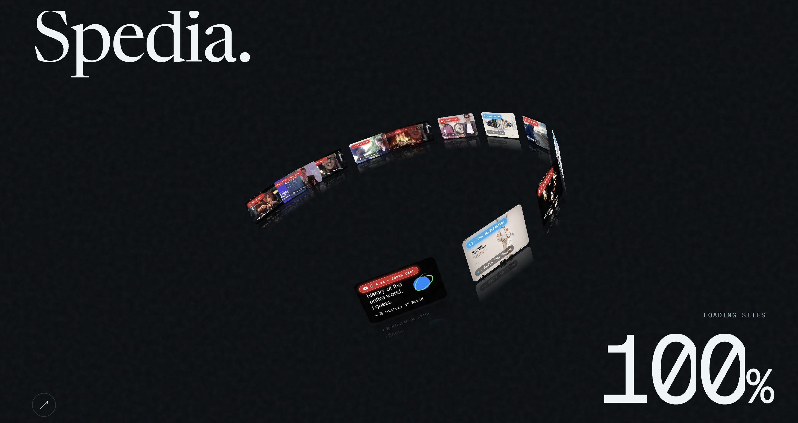
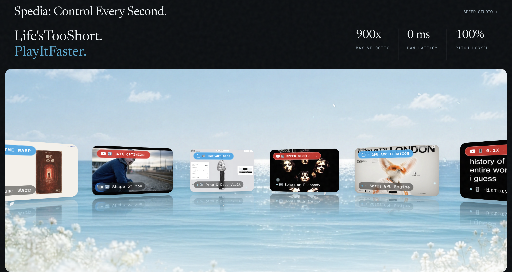
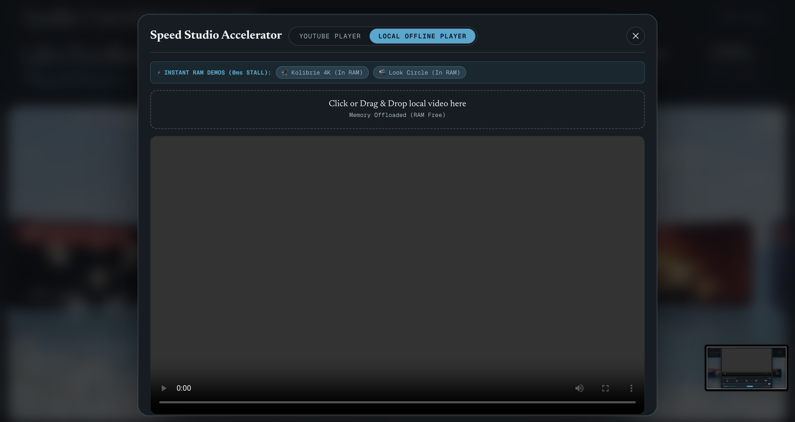
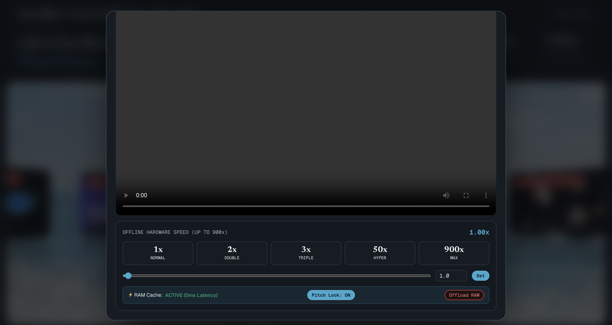
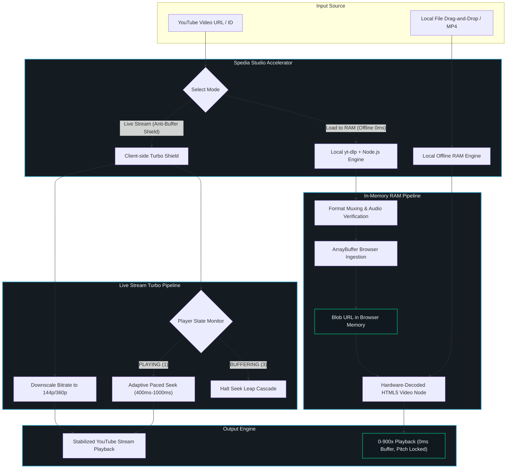
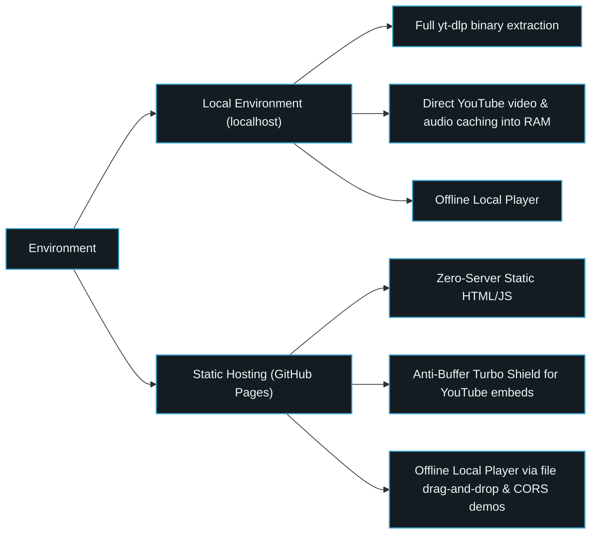

<div align="center">

# Spedia

### *Control Every Second. Life's Too Short. Play It Faster.*

A high-performance video acceleration workstation and tactile editorial interface. Engineered for continuous playback speed scaling from **0.25x** up to **900x+** with **In-Memory RAM Caching**, **Anti-Buffer Turbo Shields**, and **Dynamic Memory Offloading** for both YouTube and local offline media.

<br />

[](https://vitejs.dev/)
[](https://www.typescriptlang.org/)
[](#speed-architecture)
[](#in-memory-ram-caching-0ms-latency)
[](https://pages.github.com/)

<br />



</div>

---

## Overview

Traditional web video players are limited to 2x or 16x playback speeds. Beyond 2x, network streaming protocols suffer from chunk starvation, audio distortion, and buffer deadlocks caused by blind seeking.

**Spedia** bridges this gap by decoupling playback velocity from network bottlenecks:

1. **In-Memory RAM Accelerator**: Downloads and caches raw video bytes into browser `Blob` memory, delivering true 0ms seek leaps up to **900x** with native audio pitch preservation.
2. **Anti-Buffer Turbo Shield**: Adaptive pacing and automated quality scaling for live YouTube streams, preventing seek deadlock.
3. **Tactile Editorial Interface**: A bespoke 3D cylindrical stage of video preview cards driven by physics, drag, wheel, and touch interactions.
4. **Zero-Leak Lifecycle Offloader**: Comprehensive cleanup routines that instantly revoke ObjectURLs and destroy player instances to eliminate background CPU and battery drain.

---

## Visual Showcase

<div align="center">

### Navigation & Live Metrics Stage

<p align="left"><em>Real-time status indicators, editorial headline typography (Newsreader), and instant access to the floating Speed Studio Accelerator.</em></p>

<br />

### Speed Studio Accelerator

<p align="left"><em>Dual-view playback studio with one-click presets (1x, 2x, 3x, 50x, 100x, 900x), continuous scrubber, dynamic speed badge, and RAM preloader banner.</em></p>

<br />

### Adaptive Buffering & Memory Controls

<p align="left"><em>Configurable pacing intervals (Fast 400ms, Anti-Buffer 750ms, Keyframe 1s), real-time RAM cache allocation, pitch preservation toggles, and instant offload triggers.</em></p>

</div>

---

## System Architecture



---

## Core Capabilities

### In-Memory RAM Caching (0ms Latency)
Streaming ultra-fast video over network connections is bottlenecked by TCP round-trip delays and CDN chunk slicing. Spedia solves this by ingesting media directly into volatile browser RAM:
- **Local Dev / Desktop Mode**: Uses a backend extraction pipeline powered by `yt-dlp` and Node.js to resolve JS challenges and download video and audio in one clean operation.
- **Client-Side RAM Blob**: Once fetched, bytes are stored as a local `Blob` reference. The disk copy is immediately purged, leaving zero filesystem clutter.
- **Zero-Latency Seeking**: Because the entire file resides in RAM, seeking forward at 50x–900x incurs 0ms network latency and zero re-buffering delays.

### Anti-Buffer Turbo Shield (Live Streams)
For users streaming directly without preloading:
- **State-Aware Guard**: Senses YouTube player state transitions (`BUFFERING`, state 3) and temporarily pauses subsequent seek leaps until the current keyframe finishes decoding.
- **Configurable Pacing**: Offers adjustable leap intervals (`Fast: 400ms`, `Anti-Buffer: 750ms`, `Keyframe: 1000ms`) giving CDN nodes adequate time to deliver data packets.
- **Automatic Downsampling**: Downscales playback quality to `small` (240p/360p) during extreme multipliers, reducing network bandwidth demands by up to 85%.

### Dynamic Memory Offloading
- **Single-Click Offload**: Closes open media streams, pauses playback, halts frame-skip intervals, and invokes `URL.revokeObjectURL()` to release browser heap memory.
- **Window Lifecycle Sync**: Automatically releases allocations on tab dismissal or browser close via `beforeunload` listeners.

### Lossless Audio Pitch Preservation
- Utilizes the Web Audio and HTMLMediaElement `preservesPitch` specification.
- Speech remains intelligible and natural without chipmunk distortion across sub-2x speeds, and automatically mutes high-frequency noise spikes during extreme multipliers (>3x).

---

## Multiplier Benchmark Matrix

| Multiplier | Mode Recommended | Frame Stepping | Audio Behavior | Latency |
|:---:|:---:|:---:|:---:|:---:|
| **0.25x – 2.0x** | Live Stream or RAM | Continuous Native (1x) | Pitch Locked Full Audio | 0ms |
| **2.1x – 16.0x** | Live Stream or RAM | Native Hardware Decoded | Pitch Locked / Muted >4x | < 10ms |
| **50.0x – 100.0x** | Load to RAM (Recommended) | Paced Keyframe Leaps (400ms) | Dynamic Mute | 0ms in RAM |
| **900.0x+** | In-Memory RAM Player | Discrete Frame Stepping (50ms) | Muted | 0ms in RAM |

> **Note**: Speeds at 3x and above display the `⚠️ 3x+ requires Load to RAM to avoid buffer` safeguard to guide users toward the zero-stall offline pipeline.

---

## Dual Environment Compatibility

Spedia is built to run seamlessly across both development workstations and static production hosts:



---

## Getting Started

### Prerequisites
- Node.js (v18 or higher recommended)
- Optional for local YouTube downloads: [yt-dlp](https://github.com/yt-dlp/yt-dlp) (`brew install yt-dlp`)

### Installation & Local Setup

```bash
# Clone repository
git clone https://github.com/<username>/speedEnhancer.git
cd speedEnhancer

# Install dependencies
npm install

# Start development server
npm run dev
```

Visit `http://localhost:5173` in your browser.

### Production Build

```bash
# Typecheck and build static production assets into dist/
npm run build

# Preview the production build locally
npm run preview
```

---

## Deployment to GitHub Pages

This repository includes a preconfigured GitHub Actions workflow (`.github/workflows/deploy.yml`):

1. Push your repository to GitHub:
   ```bash
   git add .
   git commit -m "Initialize Spedia"
   git push origin main
   ```
2. In your repository on GitHub:
   - Navigate to **Settings** → **Pages**.
   - Under **Build and deployment** → **Source**, select **GitHub Actions**.
3. Every commit pushed to `main` automatically builds and publishes the static app to your GitHub Pages URL.

---

## Keyboard & Interaction Shortcuts

- **Space**: Play / Pause active modal video.
- **Mouse Wheel / Trackpad**: Rotate the 3D Sea Ring card stage.
- **Drag & Drop**: Drop any `.mp4`, `.webm`, or `.mov` file onto the Local Player zone for instant in-memory playback.
- **Escape**: Close Speed Studio modal and trigger automatic memory offloading.

